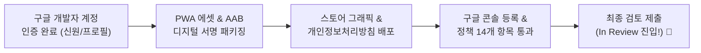
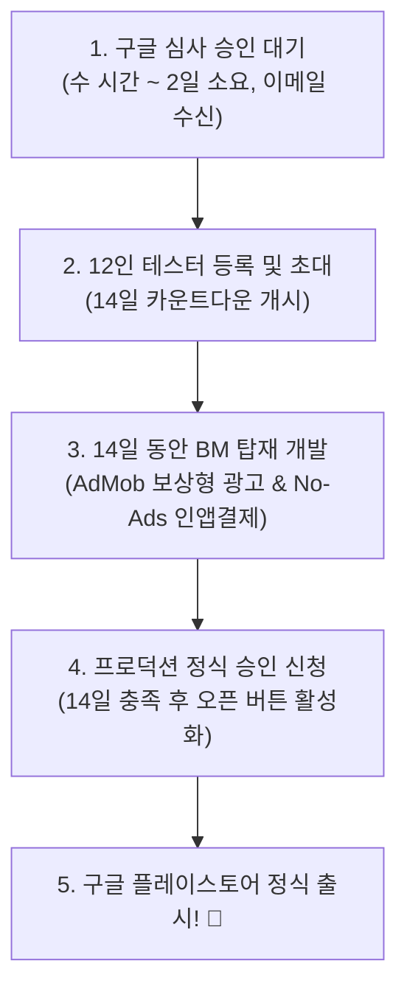

# Cosmic Striker: 구글 플레이스토어 출시 진행 내역 및 최종 보고서

> **작성 일시**: 2026년 10월 15일  
> **현재 상태**: **구글 심사팀 최종 검토 진행 중 (`In Review`)**  
> **게임 공식 명칭**: Cosmic Striker: 우주 슈팅 50  
> **공식 패키지명**: `com.joonvectord.striker`  
> **개발자 계정**: `joonvectorD` (ID: 5646715910183144688)

---

## 1. 오늘의 핵심 성과 요약 (100% 완료)

오늘 하루 동안 계정 개설부터 구글 심사 제출까지 모든 난관을 극복하고 완벽하게 접수를 마쳤습니다.

1. **구글 개발자 계정 개설 및 100% 활성화**:
   - $25 등록 수수료 결제 및 신원/주소(정부24 등본) 검증 완료
   - SMS 전화번호 인증 및 개발자 프로필(헤더 이미지 4096x2304, 아이콘 512x512) 승인 완료 (상단 경고 배너 완전 소멸)
2. **PWA 에셋 & 스토어 그래픽 에셋 구축**:
   - 스토어 표준 고해상도 아이콘 (`icon-512.png`)
   - 1024x500 필수 스토어 피처 배너 (`feature-graphic-1024x500.png`)
   - 게임 실황 16:9 고해상도 스크린샷 4종 완비 (Set 1 레벨3, 보스전 결전, 격납고 5종 기체, Set 2 초신성 성운)
3. **개인정보처리방침 웹페이지 호스팅**:
   - 배포 URL: [https://joonvector.github.io/game/shooting_game/privacy.html](https://joonvector.github.io/game/shooting_game/privacy.html) (200 OK 실시간 서비스 중)
4. **최종 AAB 빌드 및 무결성 검증**:
   - 고유 패키지명: `com.joonvectord.striker`
   - 디지털 서명 키(`signing.keystore`)로 서명된 `Cosmic_Striker_release.aab` 생성 완료
   - 구글 콘솔 내부 검증 결과 **설치 크기 2.42MB**, 다운로드 1초, API 24+, 타겟 SDK 36으로 **오류 0건 완전 통과**!
5. **구글 플레이 콘솔 비공개 테스트 제출 완료**:
   - 전 세계 177개국 배포 타겟 설정
   - 스토어 소개글(간단한 설명 및 자세한 설명 50스테이지/격납고/보스전 소개) 및 그래픽 등록
   - 14개 정책 설문(콘텐츠 등급, 타겟 연령층 만 13세 이상, 광고 ID '아니요' 선언 등) 완료
   - **`[ 검토를 위해 변경사항 14개 제출 ]` 완료 ➔ 현재 `변경사항을 검토 중입니다` 상태 진입**

---

## 2. 핵심 파일 및 자산 보관 위치

향후 업데이트 및 유지보수에 사용되는 핵심 자산 인덱스입니다:

| 항목 | 파일 / URL 위치 | 용도 및 설명 |
| :--- | :--- | :--- |
| **최종 출시 AAB** | `c:\code\android_release\Cosmic_Striker_release.aab` | 구글 콘솔에 제출된 2.42MB 최적화 번들 |
| **직접 설치용 APK** | `c:\code\android_release\Cosmic_Striker_release.apk` | 스마트폰에 직접 설치하여 즐길 수 있는 APK |
| **디지털 서명 키** | `c:\code\android_release\signing.keystore` | **[절대 분실 금지]** 향후 모든 업데이트 서명용 키 |
| **서명 비밀번호 정보** | `c:\code\android_release\signing-key-info.txt` | Key Alias: `my-key-alias` / PW: `SrSmgIobBud8` |
| **스토어 그래픽** | `c:\code\icons\` | 512 아이콘, 1024 피처 배너, 프로필 헤더 |
| **스토어 스크린샷** | `c:\code\icons\screenshots\` | 16:9 규격 스크린샷 4장 (`screenshot_1~4.png`) |
| **개인정보처리방침** | `c:\code\privacy.html` | 깃허브 배포 소스 |
| **게임 원본 소스** | `c:\code\game_shooting_v.05.html` | 정식 버전 v.05 소스코드 (추후 v.06~v.10 관리) |

---

## 3. 향후 로드맵 및 다음 일정

### 당장 준비하실 사항 (사용자 액션)
1. **구글 심사 승인 알림 이메일 대기**:
   - 구글 개발자 Gmail로 *"Google Play의 앱 업데이트가 승인되어 게시되었습니다"* 메일이 도착하면 알려주세요.
2. **테스터 12인 Gmail 리스트업**:
   - 게임을 설치하고 14일간 유지해 줄 지인/가족/친구 구글 계정(Gmail) 12개를 메모장에 모아두시면, 승인 즉시 1분 만에 등록을 마칠 수 있습니다.

---

> [!NOTE]
> 구글의 심사는 자동 및 담당자 검토로 진행되므로 지금은 편안하게 휴식을 취하셔도 좋습니다. 오늘 정말 수고 많으셨습니다!
