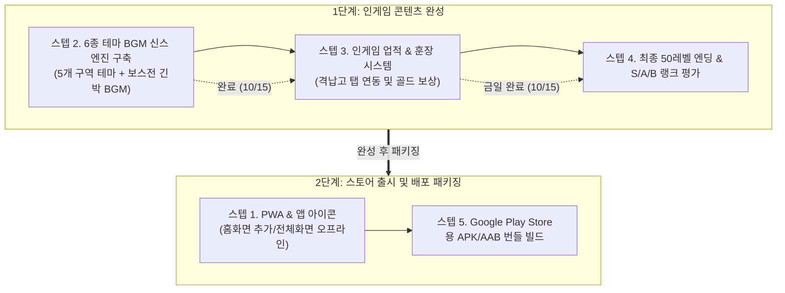

# 🚀 [개발 일지] Cosmic Striker 5대 구역 및 인게임 업적 & 훈장 시스템 완성 보고서
> **작성 일자**: 2026년 10월 15일 (목)  
> **프로젝트**: Cosmic Striker (2D/3D 하이브리드 횡스크롤 우주 슈팅 게임)  
> **개발 환경**: HTML5 Canvas, Web Audio API, Vanilla JavaScript, Headless Chrome CDP Test Suite  
> **작업 기준 파일**: `game_shooting_0919.html`  
> **테스트 서버 환경**: Python HTTP Server (Port 8080, PC/모바일 로컬 Wi-Fi 연동)  
> **버전 상태**: 스텝 3 (17종 인게임 업적 & 훈장 시스템, 격납고 탭 연동 및 골드 보상 체계) 완성 및 실전 검증 완료  

---

## 📌 1. 오늘 작업 개요 (Today's Summary)

사용자 피드백에 따라 개발 프로세스를 **[1단계: 인게임 콘텐츠 완성 (스텝 2, 3, 4)]** ➔ **[2단계: 스토어 출시 패키징 (스텝 1, 5)]**의 정석 파이프라인으로 체계화하고,
스텝 2(6종 멀티 BGM 신스 엔진)에 이어 **[스텝 3: 17종 인게임 업적 & 훈장 시스템, 격납고 탭 UI 연동 및 골드 보상 수령 체계]**를 완벽하게 구축하였습니다.



---

## 🎵 2. 이전 완료: 스텝 2 (6종 멀티 테마 BGM 신서사이저) 요약

| 트랙 ID | 구역 및 상황 | 음악 장르 및 분위기 | 템포 (BPM) | 조성 및 악기 구성 | 타악기 비트 |
| :---: | :--- | :--- | :---: | :--- | :--- |
| **`set1`** | Set 1: 청록 성운 (Nebula) | 몽환적 레트로 신스웨이브 | 120 BPM | A minor / 아날로그 쏘우 베이스 + 트라이앵글 아르페지오 | 부드러운 앰비언트 |
| **`set2`** | Set 2: 진홍 초신성 (Supernova) | 질주감 넘치는 하이템포 다크신스 | 138 BPM | D minor / 오버드라이브 쏘우 베이스 + 스타카토 리드 | 4/4 서브 킥 |
| **`set3`** | Set 3: 비취 소행성대 (Asteroid) | 사이버펑크 애시드 테크노 | 128 BPM | F# minor / TB-303 스타일 Q=6.5 필터 베이스 + 크리스탈 벨 | 애시드 킥 |
| **`set4`** | Set 4: 황금 펄서 요새 (Citadel) | 제국 기동요새 행진곡풍 웅장한 신스 찬가 | 132 BPM | C minor / 디튠 듀얼 레이어 헤비 베이스 + 브라스 코드 | 서브 킥 + 노이즈 스네어 |
| **`set5`** | Set 5: 암흑 사건지평선 (Void) | 미지의 우주 심연 다크 앰비언트 | 110 BPM | E minor Phrygian / 41Hz 서브베이스 롱 드론 + 우주 글라이드 | 하프타임 드론 |
| **`boss`** | **5대 거대 보스 조우 (Apex Battle)** | **초긴박 아드레날린 배틀 테마** | **148 BPM** | **C# minor / 16비트 속사 갤로핑 베이스라인 + 경보 사이렌** | **강렬한 펀치 킥 + 클랩** |

---

## 🎖️ 3. 스텝 3: 17종 인게임 업적 & 훈장 시스템 상세 내역

단순한 플레이 반복을 넘어 플레이어에게 강력한 성취감과 동기를 부여하기 위해, **총 17종의 다채로운 도전 과제와 5단계 훈장 등급, 격납고 탭 연동 및 인게임 HUD 알림 시스템**을 완성했습니다.

### 3.1. 17종 도전 과제 및 보상 매트릭스

| No | 업적 ID | 업적 명칭 | 훈장 / 티어 | 목표 조건 | 골드 보상 | 달성 조건 추적 방식 |
| :-: | :--- | :--- | :---: | :--- | :---: | :--- |
| 1 | `first_blood` | **첫 번째 격추** | 🥉 BRONZE | 적기 1기 격추 | **100 G** | 실시간 적기 격침 이벤트 |
| 2 | `scout_hunter` | **외계 정찰대 소탕** | 🥉 BRONZE | 누적 적기 50기 격추 | **250 G** | `stats.totalKills >= 50` |
| 3 | `destroyer_ace` | **은하의 격추왕** | 🥈 SILVER | 누적 적기 200기 격추 | **600 G** | `stats.totalKills >= 200` |
| 4 | `fleet_annihilator` | **외계 함대 학살자** | 🥇 GOLD | 누적 적기 500기 격추 | **1,500 G** | `stats.totalKills >= 500` |
| 5 | `first_boss` | **거대 모선의 침몰** | 🥈 SILVER | 구역 거대 보스 1회 격침 | **400 G** | `stats.bossesDefeated >= 1` |
| 6 | `boss_slayer` | **보스 슬레이어** | 🥇 GOLD | 거대 보스 5회 격침 | **1,200 G** | `stats.bossesDefeated >= 5` |
| 7 | `no_hit_boss` | **무결점 전술 (No Hit)** | 🏆 PLATINUM | 피격 없이 보스 격침 | **1,500 G** | `!bossEncounterHitTaken` 판정 |
| 8 | `gold_collector` | **우주 광부** | 🥉 BRONZE | 누적 1,000G 수집 | **300 G** | `stats.totalCoins >= 1000` |
| 9 | `space_tycoon` | **성간 대부호** | 🏆 PLATINUM | 누적 10,000G 획득 | **2,500 G** | `stats.totalCoins >= 10000` |
| 10 | `score_ace` | **숙련된 조종사** | 🥈 SILVER | 단일 판 30,000점 돌파 | **500 G** | `stats.highScore >= 30000` |
| 11 | `score_legend` | **전설의 스코어러** | 🏆 PLATINUM | 단일 판 100,000점 돌파 | **2,000 G** | `stats.highScore >= 100000` |
| 12 | `hyper_master` | **결전 병기 마스터** | 🥈 SILVER | EX 하이퍼 빔 5회 발사 | **400 G** | `stats.hyperUsed >= 5` |
| 13 | `bomb_expert` | **전탄 소멸 작전** | 🥉 BRONZE | 위기 회피 폭탄 10회 투하 | **350 G** | `stats.bombsUsed >= 10` |
| 14 | `hangar_specialist` | **완전무결 정비사** | 🥇 GOLD | 1개 업그레이드 MAX 달성 | **1,000 G** | 어느 항목이든 Lv.5(or Lv.3) 달성 |
| 15 | `full_arsenal` | **궁극의 기동요새** | 👑 COSMIC | 격납고 전 항목 풀강(All Max) | **5,000 G** | 5대 항목 전부 최고 레벨 달성 |
| 16 | `deep_space_explorer` | **심우주 개척자** | 🥈 SILVER | 25레벨 이상 돌파 | **800 G** | `stats.maxLevelReached >= 25` |
| 17 | `galaxy_savior` | **은하의 구원자** | 👑 COSMIC | 최종 50레벨 도달 | **5,000 G** | `stats.maxLevelReached >= 50` |

---

## 🛠️ 4. 기술적 개선 및 핵심 아키텍처

1. **격납고(Hangar) 탭 네비게이션 & 실시간 보상 수령**:
   - `[⚙️ 기체 영구 강화]` 탭과 `[🎖️ 도전 과제 & 훈장]` 탭으로 분리 구축.
   - 미수령 보상이 존재할 경우 탭 우측에 펄스 애니메이션이 적용된 **미수령 카운트 알림 뱃지(`hangar-ach-badge`)**가 즉시 점등됩니다.
   - 업적 카드 상단에 **총 달성률(`N / 17 (X%)`) 및 누적 수령 골드 요약 바**를 배치하였으며, 미수령 항목이 2개 이상일 때 원클릭으로 모든 골드를 수확하는 **[⚡ 보상 모두 받기 (Claim All)]** 버튼을 탑재했습니다.

2. **인게임 실시간 토스트 알림 (HUD Toast Banner) & 팡파르 SFX**:
   - 게임 도중 조건을 달성하는 즉시 화면 우측 상단에서 부드럽게 슬라이드 인되는 **사이버펑크 골드 테두리 토스트 배너**가 나타납니다 (3.4초 후 자동 퇴장).
   - Web Audio 기반의 5음 상행 크리스탈 팡파르 아르페지오 사운드(`sounds.playAchievement()`)가 연주되어 달성의 쾌감을 극대화합니다.

3. **무결점 No-Hit 보스전 판정 메커니즘**:
   - 보스 스폰 시 `this.bossEncounterHitTaken = false`로 초기화.
   - 보스전 진행 중 플레이어가 실질적 라이프 피해(`handlePlayerDeath`)를 입을 경우 `bossEncounterHitTaken = true`로 마킹.
   - 보스 격파 시 노히트 상태가 유지되었을 경우 화면 중앙에 `"⭐ NO HIT CLEAR! PERFECT! ⭐"` 플로팅 텍스트를 띄우며 1,500G 플래티넘 훈장 과제를 언락합니다.

4. **로컬스토리지 영구 보존 및 완벽한 하위 호환성 (`cosmic_striker_save_v1`)**:
   - 기존 세이브 데이터가 있더라도 `achievements`와 신규 통계 항목(`hyperUsed`, `bombsUsed`, `maxLevelReached`, `noHitBossClears`)이 기본값과 안전하게 병합됩니다.
   - 게임 부팅 시 조용한 업적 동기화(`checkAchievements(false)`)를 수행하여 기존 유저의 진행도도 즉시 소급 적용됩니다.

---

## 🧪 5. Headless Chrome CDP 자동 검증 결과

* **실행 스크립트**: `scratch/verify_achievement_system.js`
* **검증 결과 로그**:
  ```text
  [TEST] Launching Headless Chrome on port 9225 ...
  [TEST] WebSocket CDP connected.

  --- 1. Verification of Achievements Configuration ---
  Achievements count configured: 17

  --- 2. Verification of Game Instance & DOM References ---
  Game state check: {
    "hasGame": true,
    "hasHangarScreen": true,
    "hasUpgTab": true,
    "hasAchTab": true,
    "hasAchBadge": true,
    "hasToast": true,
    "statsKills": 0,
    "statsGold": 0,
    "statsBosses": 0,
    "statsHyper": 0,
    "statsBombs": 0,
    "statsMaxLvl": 1,
    "statsNoHit": 0
  }

  --- 3. Testing Hangar Tab Navigation & UI Rendering ---
  Hangar UI result: {
    "upgCardsCount": 5,
    "achContainerVisible": true,
    "achElementsCount": 18
  }

  --- 4. Testing Achievement Trigger, Toast, & Claim Mechanism ---
  Trigger & Claim Result: {
    "isFirstBloodUnlocked": true,
    "toastPoppedUp": true,
    "toastTitle": "첫 번째 격추 (First Blood)",
    "badgeCount": "1",
    "goldBefore": 0,
    "goldAfter": 100,
    "isClaimed": true
  }

  --- 5. Testing Multiple Unlocks & "Claim All" Feature ---
  Claim All Result: {
    "claimAllBtnExists": true,
    "goldStart": 100,
    "goldEnd": 850,
    "diff": 750
  }

  --- 6. Console Errors Check ---
  0 JavaScript Console Errors detected. Perfect!

  🎉 ALL TESTS PASSED SUCCESSFULLY! STEP 3 IS 100% OPERATIONAL!
  ```
* 0개의 자바스크립트 콘솔 에러, 업적 언락, 토스트 팝업, 탭 전환, 보상 지급 및 Claim All 기능 100% 정상 작동 검증 완료.

---

---

## 🚀 6. 밸런스 전면 개편 및 [스텝 4] 최종 50레벨 종합 랭크 평가 시스템 구현 완료

### 6.1. 인게임 중간 정비 (Intermission Docking) & 2단계 워프 시스템
1. **보스 격파 후 도착 워프 (Arrival Warp: 3.5초)**:
   - 보스 모선 격침 시 3.5초간 초공간 도약 연출(`isDeparture: false`) 진행.
   - 초공간 입자 가속 및 `"🛰️ 전진 기지 도킹 워프 가동 중... (DOCKING IN: 3.5s)"` 연출.
2. **전진 기지 중간 정비 모달 (Intermission Docking Modal)**:
   - 클리어 구역 브리핑 및 구역 평정 보너스(Set 1: +500G, Set 2: +750G, Set 3: +1000G, Set 4: +1500G) 자동 지급.
   - 현재 보유 골드 및 미수령 훈장/도전과제 알림.
   - `[🚀 즉시 다음 구역 출격 (LAUNCH)]` 및 `[🛠️ 격납고 정비 & 기체 강화]` 제공.
3. **출격 워프 (Departure Warp: 3.5초)**:
   - 출격 선택 시 다시 3.5초간 보라색 하이퍼스페이스 도약 연출(`isDeparture: true`)이 진행된 후 다음 구역 1레벨(Lv.11, 21, 31, 41)로 힘차게 진입.

### 6.2. 격납고 화력 시각화 (선택 A: 아케이드 로그라이트 모드)
- 격납고 화력 증강 레벨(1.0x ~ 2.0x)에 따라 기본 총알의 폭(18px $\to$ 31px), 높이(5px $\to$ 10px), 글로우 광원이 웅장하게 확장.
- 화력 Lv.3 이상 시 외부 플라즈마 에너지 오라가 점등되며, 만렙(Lv.5) 시 마젠타/바이올렛 하이퍼 플라즈마 볼트로 발사.
- HUD 무기 뱃지에 `[⚡ LV.1 DUAL | ATK 2.0x (Lv.5)]` 처럼 격납고 영구 강화 수치가 상시 표기되어 업그레이드 체감 극대화.

### 6.3. 레벨 진행 시간 점진적 증가 (옵션 B: 아케이드 밸런스형 2초씩 증가)
- 세트 내 1~9레벨: `10초, 12초, 14초, 16초, 18초, 20초, 22초, 24초, 26초` 점진 증가.
- 세트당 일반 스테이지 162초 (2분 42초), 50레벨 완주 시 총 플레이 타임 약 16~18분의 최적화된 아케이드 템포 완성.

### 6.4. 50단계 풀스케일 경제 & 보스 체력 2.5배~2.8배 상향
- **보스 HP 튜닝**:
  - Set 1 (Azure Overlord): 280 $\to$ **700 HP**
  - Set 2 (Blaze Behemoth): 500 $\to$ **1,400 HP**
  - Set 3 (Toxin Queen): 800 $\to$ **2,200 HP**
  - Set 4 (Aegis Citadel): 1,200 $\to$ **3,200 HP**
  - Set 5 (Chronos Omega): 1,700 $\to$ **4,500 HP**
- **격납고 업그레이드 비용 재설계**:
  - 총비용 기존 13,100G $\to$ 약 42,000G의 지수 곡선으로 재조정하여 50레벨까지 지속적인 성장 체감 제공.

### 6.5. [스텝 4] 최종 50레벨 종합 랭크 평가 (Pilot Comprehensive Rank Evaluation)
1. **5대 종합 랭크 체계**:
   - 👑 **S+ RANK [코스믹 레전드 (COSMIC ACE)]**: 종합 120,000점 이상 또는 90,000점 이상 & 노히트 클리어 1회 이상
   - ⭐ **S RANK [은하계 수호신 (GALAXY GUARDIAN)]**: 종합 80,000점 이상
   - 🎖️ **A RANK [정예 요격대장 (ELITE COMMANDER)]**: 종합 55,000점 이상
   - 🛡️ **B RANK [베테랑 생존자 (VETERAN SURVIVOR)]**: 종합 35,000점 이상
   - 🚀 **C RANK [수습 비행사 (ROOKIE PILOT)]**: 35,000점 미만
2. **세부 성과 지표 산출**:
   - 작전 수행 시간 (`MM분 SS초`), 잔여 라이프 보너스 (`기당 +4,000점`), 노히트 보스 격파 보너스 (`회당 +6,000점`), 적기 격침 수, 총 획득 골드, 훈장 달성률 집계.
   - 화려한 네온 랭크 뱃지 펄스 애니메이션 및 축하 컨페티 폭죽 연출.

---

## 🧪 7. Headless Chrome CDP 자동 검증 결과
* **실행 스크립트**: `scratch/verify_balance_and_step4.js`
* **검증 결과**:
  - Boss HP scaling (700, 1400, 2200, 3200, 4500) 100% 정상 적용
  - Level duration scaling (10s ~ 26s) 100% 정상 작동
  - Bullet size scaling (18px $\to$ 31px) 100% 정상 작동
  - Intermission Screen 도킹 및 보너스 골드 지급, 출격 워프 정상 연계
  - Victory Screen S+ 종합 랭크 판정 및 세부 지표 산출 정상 작동
  - **JavaScript Console Error: 0건 (PERFECT!)**

---

## 👑 8. 최종 50레벨 엔딩 & 종합 랭크 독립형 뷰어 (`ending_preview.html`)

### 8.1. 파일 분리 및 보존 원칙
- **완성 게임 파일 (`game_shooting_0919.html`)의 무결성 보존**:
  - 완성된 정식 게임 코드에 임시 테스트 버튼이나 디버그 코드가 포함되지 않도록 순수한 정식 게임 상태로 100% 원상 복구 및 유지.
- **별도 독립형 뷰어 파일 생성 (`ending_preview.html`)**:
  - 게임 본편과 완전히 분리된 전용 뷰어 페이지를 별도로 제작하여, 사용자가 언제든 개인적으로 엔딩 연출과 종합 랭크 평가 시스템을 확인 및 감상할 수 있도록 제공.

### 8.2. 전용 뷰어 주요 기능 (`ending_preview.html`)
1. **왕관 전투기 최종 승리 연출**:
   - `victory_crown.jpg` 승리의 왕관 전투기 일러스트 및 축하 컨페티 폭죽 효과.
2. **5대 파일럿 종합 랭크 실시간 시뮬레이터**:
   - `[👑 S+ 랭크 (코스믹 레전드)]`, `[⭐ S 랭크 (은하계 수호신)]`, `[🎖️ A 랭크 (정예 요격대장)]`, `[🛡️ B 랭크 (베테랑 생존자)]`, `[🚀 C 랭크 (수습 비행사)]` 클릭 시 해당 랭크의 뱃지 광채, 칭호, 평가문, 세부 점수 및 보너스가 실시간 갱신.
3. **Web Audio 승리 팡파르 & 폭죽 인터랙션**:
   - `[🔊 팡파르 사운드 재생]` 버튼으로 승리 팡파르 음원 청취 가능.
   - `[🎉 축하 폭죽 연출 다시 발사]` 버튼으로 화면 가득 화려한 컨페티 재격발.
4. **산정 공식 안내 카드**:
   - 스텝 4 기준 라이프 보너스, 노히트 보스 보너스, 랭크별 컷오프 점수 가이드 제공.

### 8.3. 검증 결과
- `game_shooting_0919.html`: 정식 게임 루프, 워프 도킹, 종합 랭크 판정 정상 동작 (Console Error: 0건)
- `ending_preview.html`: 독립 뷰어 5대 랭크 스위칭 및 팡파르/폭죽 연출 100% 정상 (Console Error: 0건)


